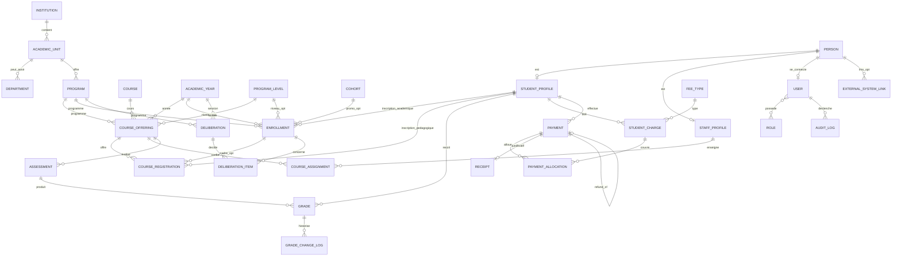

# MCD — Modèle Conceptuel de Données (SIGU-UWB)

**Statut :** proposition technique phase 2.1 (post-audit) — à valider avant PostgreSQL métier.  
**Classification :** sauf mention « confirmé E1 », les entités métier sont des **propositions** ; les règles chiffrées restent en **attente UWB**.

Légende cardinalités : `1` = un, `N` = plusieurs, `0..1` / `0..N` = optionnel.

---

## 1. Domaine A — Structure universitaire

| Entité | Attributs principaux | Associations | Classification |
|---------|----------------------|--------------|----------------|
| **Institution** | id, nom, sigle, devise | **1 — 0..N** AcademicUnit | Proposition |
| **AcademicUnit** | id, code, nom, type*, statut | **1 — 0..N** Department ; **1 — 0..N** Program | Proposition — liste **attente** |
| **Department** | id, code, nom | **N — 1** AcademicUnit ; **0..N** StaffAssignment | Proposition — **créer seulement si UWB confirme** |
| **Program** | id, code, intitulé, cycle*, diplôme* | **1 — N** CourseOffering ; **1 — N** Enrollment | **Attente** intitulés |
| **AcademicYear** | id, libellé, dates*, est_courante | Réf. Enrollment, Offering, Charge, Deliberation, Registration | **Attente** dates |
| **ProgramLevel** | id, code, libellé, ordre | Utilisé par Enrollment, Offering (niveau d’études) | Proposition — nomenclature **attente** |
| **Cohort** *(Promotion)* | id, code, année d’entrée*, libellé | **0..N** StudentProfile ou Enrollment (selon règle) | Proposition — **distinct de ProgramLevel** ; **attente** existence |
| **Course** | id, code, intitulé, crédits* | **1 — N** CourseOffering | Proposition |
| **CourseOffering** | id | **N — 1** Course ; **N — 1** Program ; **N — 1** AcademicYear ; **0..1** ProgramLevel ; **0..N** CourseAssignment ; **0..N** CourseRegistration ; **0..N** Assessment | Proposition technique |

\* À confirmer UWB.

**Note nomenclature :** le terme `ProgramCourseOffering` est **abandonné** ; seul **`CourseOffering`** est retenu.

---

## 2. Domaine B — Étudiants et inscriptions

| Entité | Attributs principaux | Associations | Classification |
|---------|----------------------|--------------|----------------|
| **Person** | id, noms, contacts | **0..1** User ; **0..1** StudentProfile ; **0..1** StaffProfile | Proposition — **source de vérité identité** |
| **StudentProfile** | id, matricule, date entrée* | **1 — 1** Person ; **1 — N** Enrollment ; **1 — N** CourseRegistration | Proposition |
| **Application** | id, statut | **N — 1** Person (+ program, year) | Optionnel — **attente** processus |
| **Enrollment** | id, kind*, **status**, dates | **N — 1** StudentProfile ; **N — 1** Program ; **N — 1** AcademicYear ; **0..1** ProgramLevel ; **0..1** Cohort | Proposition |
| **EnrollmentDocument** | id, type, stockage, validation | **N — 1** Enrollment | Proposition |
| **CourseRegistration** | id, status | **N — 1** StudentProfile ; **N — 1** CourseOffering ; lien logique vers Enrollment | **Proposition à valider (Q32)** |

### Statuts d’Enrollment (proposition technique — libellés non officiels)

`draft` | `active` | `completed` | `withdrawn` | `cancelled` | `deferred`  
Les années antérieures conservent leurs lignes avec un statut terminal (`completed`, etc.).

### Unicité Enrollment — options (**attente Q6**)

Voir `06-architecture-donnees.md` §4 (options A / B / C). Aucune option n’est imposée comme règle UWB.

---

## 3. Domaine C — Personnel

| Entité | Associations |
|---------|--------------|
| **StaffProfile** | **1 — 1** Person |
| **StaffAssignment** | Staff — AcademicUnit et/ou Department ; historique dates |
| **CourseAssignment** | Staff — CourseOffering |

---

## 4. Domaine D — Comptes (E1 + extension)

| Entité | Associations | Classification |
|----------|--------------|----------------|
| **User** | **0..1** Person ; **N — N** Role | Confirmé E1 ; `person_id` = **proposition** |
| **Role** | **N — N** User | Confirmé E1 |
| **Permission** / RolePermission | Phase ultérieure | Reporté D-013 |
| **AuditLog** | User 0..1 — N | Proposition |

Rôle proposé **academic_affairs** (scolarité) : **attente** validation (séparation admin / scolarité / finance / enseignant).

---

## 5. Domaine E — Notes

| Entité | Associations | Classification |
|---------|--------------|----------------|
| **Assessment** | **N — 1** CourseOffering | Proposition |
| **Grade** | **N — 1** Assessment ; **N — 1** StudentProfile ; cohérence via **CourseRegistration** sur la même Offering | Proposition |
| **GradeChangeLog** | **N — 1** Grade ; append-only | Proposition |
| **Deliberation** | AcademicYear + Program (+ Level optionnel) | Proposition — **règles métier attente** |
| **DeliberationItem** | Deliberation — Enrollment (ou Student+Program+Year) | Proposition |

---

## 6. Domaine F — Finances

| Entité | Associations | Classification |
|---------|--------------|----------------|
| **FeeType** | Catalogue | **Attente** montants |
| **StudentCharge** | Student — Year — FeeType | Proposition |
| **Payment** | Student ; statuts ; remboursement → Payment d’origine | Proposition |
| **PaymentAllocation** | Payment — Charge | Proposition |
| **Receipt** | **0..1 — 1** Payment **confirmed** | Proposition |

---

## 7. Domaines G–I — Backlog (hors v1 migration)

| Domaine | Entités | Note |
|---------|----------|------|
| E-learning | **ExternalSystemLink**, LearningResourceRef | Intégration — pas reconstruction LMS |
| Messagerie | Conversation, Message, MessageRecipient, Attachment, Notification | Backlog |
| Assistant IA | ApprovedKnowledgeDocument, **AiThread**, AiMessage | Backlog ; ACL |

---

## 8. Diagramme Mermaid (post-correction)

---

## 9. Intégrité conceptuelle

- Matricule étudiant unique dans la portée retenue (institution ou global — **attente** si multi-établissements).  
- Person ≠ User ; identité via Person si liée.  
- Historique académique = lignes Enrollment par année + statuts.  
- Une **Grade** n’est cohérente que si l’étudiant a une **CourseRegistration** sur l’offering de l’Assessment (règle proposition).  
- Paiements confirmés / remboursés : pas de suppression physique ; reçus seulement si `confirmed`.
